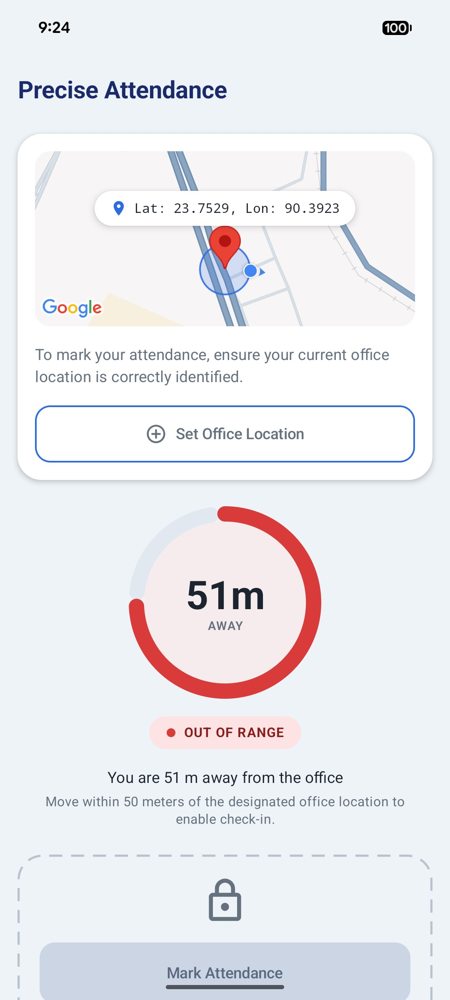
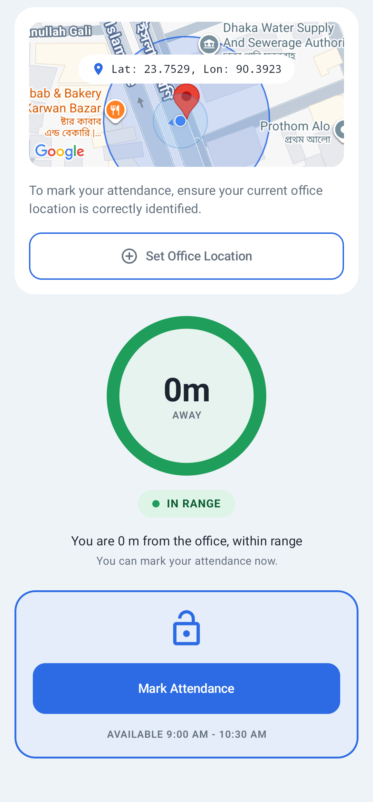
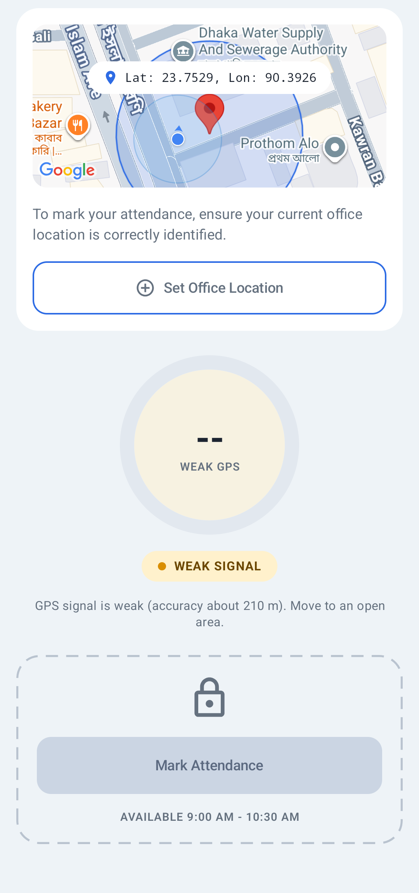
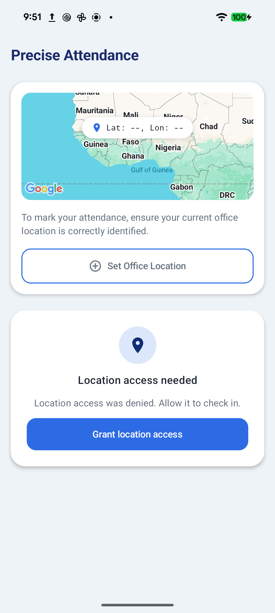
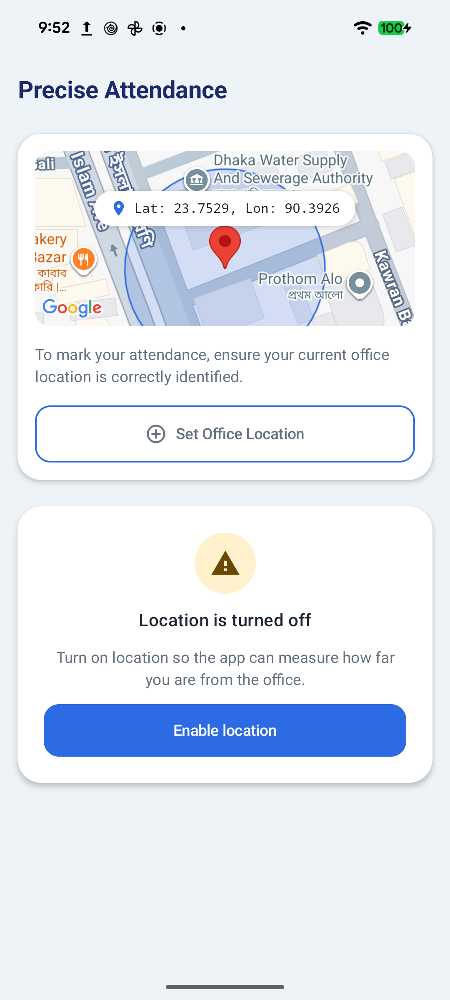
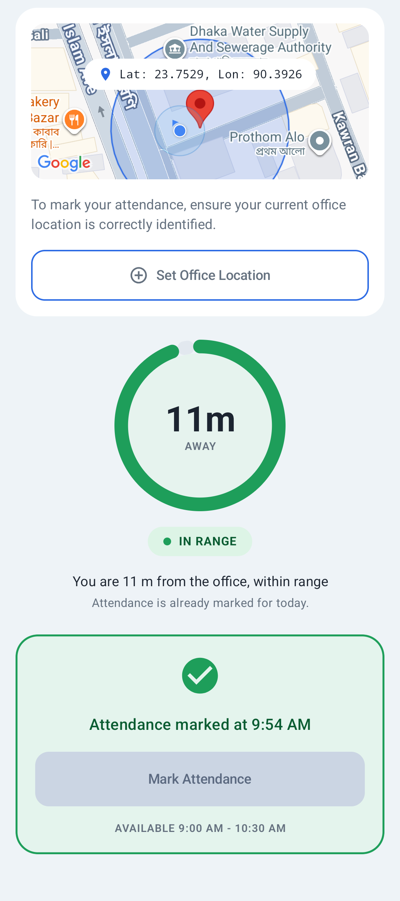
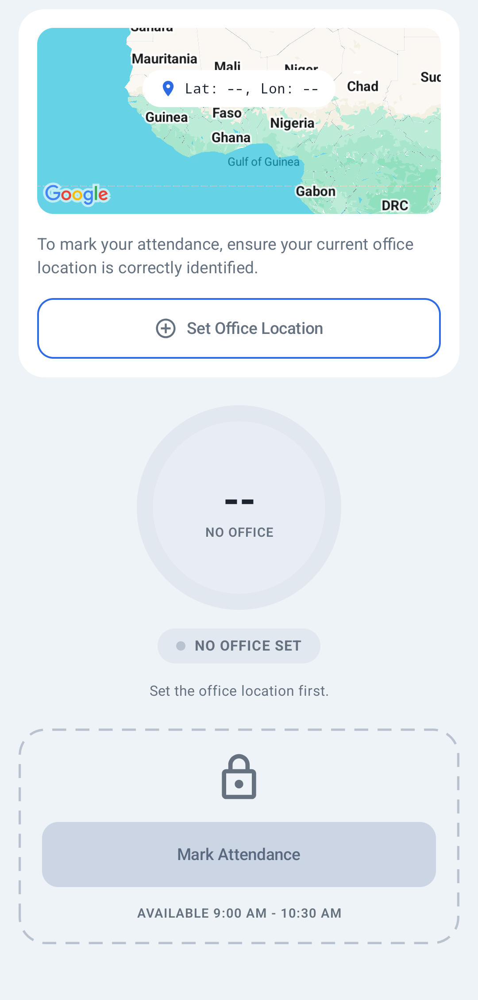

# Precise Attendance

Geo-fenced attendance for Android.

## 1. Project Title and Description

**Precise Attendance** is a single-screen Android app. The user saves the office position once, then the app measures the distance to it live and only allows "Mark Attendance" when the user is within 50 metres of that point, with a trustworthy GPS fix, inside the attendance window.

This repository is **Task 1 (native Android, Jetpack Compose)** of the assessment. Task 2 (Flutter) is in a separate repository: [snapsync-flutter](https://github.com/mknishad/snapsync-flutter).

### Features

- **Set Office Location.** Takes a fresh high-accuracy GPS fix (15 second timeout) and saves it locally. A fix with accuracy worse than 30 m is rejected with a clear message instead of being saved.
- **Live distance indicator.** A ring, a status chip and a sentence such as "You are 120 m away from the office", updated about every 2 seconds.
- **Guarded check-in.** Mark Attendance is enabled only when all of these hold: precise location permission, location services on, a fix accurate to 30 m or better, a distance of 50 m or less (inclusive), the time inside the attendance window, and attendance not already marked today.
- **Re-validation on tap.** The tap does not trust what the screen showed. It takes a fresh fix and re-checks the office, window, accuracy and distance before recording anything.
- **Permission and hardware states.** Not asked yet, denied, permanently denied, approximate-only location, location services off (with the system "turn on location" prompt), no fix yet, weak accuracy, location timeout, and storage failure each have their own message or card.
- **Local persistence.** The office position (full double precision) and the last attendance time are stored with Jetpack DataStore. Nothing leaves the device and Android backup is disabled.
- **Optional map.** With a Maps API key the office is shown on a non-interactive map with a marker and a 50 m circle. While permission is granted and location is on, the map's own blue dot shows your current position, and the camera zooms out in whole steps so the dot stays in view when you are further away. The dot comes from the Maps SDK and is a display aid only; it does not use the app's 30 m accuracy check. Without a key, or without Google Play services, a styled placeholder is shown and everything else works.
- **Presentation.** Light and dark themes, a scrollable layout that holds up at 200 percent font size, TalkBack descriptions on the ring, chip and disabled button.

## 2. Project Structure / Approaches

### Architecture

The app uses a layered MVI architecture with unidirectional data flow.

- **UI layer** (`ui/`): Compose screens and the `AttendanceViewModel`. The ViewModel exposes one immutable `StateFlow<AttendanceUiState>`, a `Flow` of one-off `AttendanceUiEvent`s, and a single `onIntent(AttendanceIntent)` entry point, so the screen is a pure function of the state.
- **Domain layer** (`domain/`): models, rules and use cases written in plain Kotlin. It has no Android imports; the only framework dependency is the `javax.inject` annotations.
- **Data layer** (`data/`): the Fused Location client, the location-services monitor and DataStore, behind domain interfaces.
- **Dependency injection** (`di/`): Hilt modules. The `Clock`, `DistanceCalculator` and `AttendanceWindow` are provided there so tests can replace them.

### Package tree

```
com.monir.preciseattendance
├── MainActivity.kt, PreciseAttendanceApp.kt
├── di/            DataStoreModule, DomainModule, LocationModule, RepositoryModule, DeviceZoneClock
├── domain/
│   ├── model/     GeoPoint, OfficeLocation, LocationFix, ProximityResult, FixResult, LocationError,
│   │              AttendancePolicy, AttendanceWindow, AttendanceStatus
│   ├── geo/       DistanceCalculator, HaversineDistanceCalculator, ProximityEvaluator
│   ├── repository/ LocationRepository, OfficeLocationRepository, AttendanceRepository
│   └── usecase/   ObserveProximity, SetOfficeLocation, MarkAttendance
├── data/
│   ├── location/  FusedLocationRepository, LocationServicesObserver, LocationMapper
│   ├── local/     OfficeLocationStore, AttendanceStore, PreferencesFlow
│   └── repository/ OfficeLocationRepositoryImpl, AttendanceRepositoryImpl
└── ui/
    ├── attendance/ AttendanceScreen, AttendanceContent, AttendanceViewModel, AttendanceUiState,
    │               AttendanceIntent, AttendanceUiEvent, StatusMessage, and display helpers
    │   └── components/ OfficeStepCard, OfficeMap, DistanceRing, StatusChip, CheckInCard,
    │                   PermissionCard, LocationOffCard, and supporting pieces
    ├── location/   permission requester, location-settings resolver, app-settings intent
    └── theme/      Material 3 colours (including success and warning roles), shapes, typography
```

### Main classes

- **`AttendanceViewModel`** combines the proximity flow, the office, the location-services flag, the last attendance time and a clock ticker into the single UI state. It starts location collection only when permission is granted and location is on, and handles every intent and result.
- **`ObserveProximity`** turns the saved office and the live fixes into a `ProximityResult`: `NoOfficeSet`, `AcquiringFix`, `WeakSignal`, `InRange`, `OutOfRange` or `LocationUnavailable`. It requests no location updates while no office is saved.
- **`ProximityEvaluator`** is the single place that decides whether a fix counts as in range. Both the live flow and the tap-time check use it.
- **`SetOfficeLocation`** gets a fresh fix, rejects it if the accuracy is too poor, otherwise saves it, and returns a typed result for each failure.
- **`MarkAttendance`** re-validates at the moment of the tap and records the timestamp, returning a typed result for each failure reason.
- **`FusedLocationRepository`** wraps `FusedLocationProviderClient`: high-accuracy updates every 2 seconds as a `callbackFlow`, a one-shot fresh fix with a timeout, and typed errors instead of exceptions.
- **`LocationServicesObserver`** reports whether location is switched on and reacts to changes through a broadcast receiver that is unregistered when collection stops.
- **`OfficeLocationStore` and `AttendanceStore`** persist the office and the last attendance time in DataStore Preferences. `OfficeLocationRepositoryImpl` and `AttendanceRepositoryImpl` expose them through the domain interfaces.

### Key design decisions

- **Accuracy gating.** A fix reporting accuracy worse than 30 m (or no usable accuracy) produces `WeakSignal`, never `InRange` or `OutOfRange`. A poor GPS fix therefore cannot enable check-in, and cannot be saved as the office. The 30 m threshold is a choice made here; the brief does not specify one. Both thresholds live in `AttendancePolicy`.
- **Tap-time re-validation.** `isMarkAttendanceEnabled` only controls the button. `MarkAttendance` checks again with a fresh fix, so a stale "in range" screen cannot record attendance. The window is checked before and after the fix because getting a fix can take seconds.
- **Lifecycle-aware location collection.** The state is shared with `WhileSubscribed(5_000)` and collected with `collectAsStateWithLifecycle`, so updates stop about 5 seconds after the screen leaves the started state. Collection also stops while permission is missing or location is off, and restarts without recreating the ViewModel. A unit test covers the stop; on the emulator the system's GPS request goes off shortly after backgrounding (Android also withholds background location itself, so that observation alone does not prove the app's own behaviour).
- **Full-precision coordinate storage.** Latitude and longitude are stored as `Double` preferences with no `Float` or string conversion. A unit test round-trips values that differ only in the last bit. The four-decimal figures on screen are display formatting only.
- **Maps key fallback.** The key is read at build time from the gitignored `local.properties` into a manifest placeholder. Only a boolean, `BuildConfig.MAPS_KEY_AVAILABLE`, is compiled into the code. When it is false, or Play services are unavailable, a placeholder replaces the map.
- **Other.** Failures are typed values rather than exceptions that reach the UI. The attendance window uses an injected `Clock` that reads the device time zone on every call.

### Assumptions

- The attendance window is **09:00 to 10:30**, taken from the reference screenshot. Both ends are inclusive, it does not cross midnight, and it is evaluated in the device's current time zone. Change it in `AttendanceWindow`.
- The allowed radius is 50 m (inclusive), as in the brief. The 30 m accuracy limit and the 200 m distance ring maximum are design choices.
- There is one office. Setting it again replaces the previous one.
- Attendance is recorded locally as the last timestamp only. There is no backend and no history. "Today" is the device's calendar day, and the device clock is trusted.
- Approximate-only location is treated as not enough. Check-in needs precise location.
- Distance is spherical (haversine, earth radius 6,371,008.8 m), which is accurate enough at the 50 m scale.
- Mock locations are not detected or rejected, which is what makes the test steps below possible.

## 3. Generative AI Usage

This project was built with **Claude Code**, Anthropic's coding assistant, working inside the repository. The complete prompts are in [PROMPTS.md](PROMPTS.md); condensed key instructions are below.

### How it was used

- **Scaffolding.** Gradle version catalog with current versions looked up rather than recalled, Hilt, DataStore, Maps wiring, `.gitignore`, package structure and stubs.
- **Logic and boilerplate.** The domain rules, location and storage layers, use cases, ViewModel and the permission and location-settings helpers.
- **UI.** The Compose screen and its components, the theme and previews, built against the reference screenshot.
- **Tests.** Unit tests (JUnit 4, MockK, Turbine, coroutines-test) and Compose UI tests. The AI ran the unit tests and the instrumented UI tests on an Android emulator, and exercised the release build there with mock locations.
- **Review.** Each step ended with a verification run. In the final audit the AI also found and fixed defects in its own earlier work: an experimental R8 `packageScope` setting that excluded the app's own code from shrinking, and a launch crash, seen on an API 36 emulator whenever a Maps key was present, caused by a missing `org.apache.http.legacy` library declaration in the manifest.

The AI did not test on a physical device.

### Essential prompts (condensed from PROMPTS.md)

1. **Scaffolding.** "Build a native Android app ... Do project setup and scaffolding ONLY. Do not implement feature logic yet." It required a version catalog ("Look up the current stable versions of every library and plugin yourself; do not guess versions from memory") and "read the API key from local.properties (key name MAPS_API_KEY) ... Never hardcode the key ... The app must still build and run when no key is present."
2. **Data and domain.** "A fix whose accuracy is worse than the maximum must produce WeakSignal rather than InRange/OutOfRange, so a poor GPS fix can never enable check-in." and "MarkAttendance: re-validates at the moment of the tap (fresh proximity check AND time window), not only trusting the last UI state." and "Store latitude and longitude with full Double precision (do not round them via Float or string formatting)."
3. **Presentation logic.** "location updates must only be collected while the screen is active and permission is granted" and "treat approximate-only as a distinct state, explain it, and do not allow check-in with it."
4. **UI.** "build the real Jetpack Compose UI for AttendanceScreen to match the attached reference screenshot ... Do not change domain or data logic." and "Use Maps Compose only when a Maps API key is present. Expose a BuildConfig boolean ... without ever putting the key itself in BuildConfig or source."
5. **Release and audit.** "harden and verify the release build, audit the project against the assessment brief, and complete README.md. Do not add features. Only fix defects you find, and tell me about each one."

### What I verified or changed myself

I conducted making the architecture decision. Tested the app on a Pixel 8 (API 37) and on a Pixel 5a (API 34) and the UI and functionality is working properly. Tweaked some of the UI by hand and removed some unnecessary components. Ran the tests and verified that they pass.

## 4. How to Run

### Prerequisites

- **Android Studio** Quail 4 (2026.1.4) or newer. The project uses Android Gradle Plugin 9.4.1, and that is the oldest Studio release Google's compatibility table lists for AGP 9.4.
- **JDK.** The Gradle wrapper (9.6.0) is configured to run on JDK 25 (`gradle/gradle-daemon-jvm.properties`) and downloads it automatically on the first build, so the first build needs internet access. The code compiles to Java 17.
- **Android SDK Platform 37** (compileSdk and targetSdk are 37). Android Studio offers to install it.
- **Device.** minSdk is 26 (Android 8.0). The device or emulator needs Google Play services for the location client; use an emulator image that includes Google APIs or Google Play. A physical device with GPS is best for real testing.

### Clone and open

```bash
git clone git@github.com:mknishad/precise-attendance-android.git
cd precise-attendance-android
```

Open the folder in Android Studio and let Gradle sync, or use the command line below.

### Optional: Maps API key

The app builds and runs without a key. Without one, a styled placeholder replaces the map.

To show the real map, create a key with the Maps SDK for Android enabled, then add it to `local.properties` in the project root (this file is gitignored):

```properties
MAPS_API_KEY=<your key>
```

Rebuild after changing it. `local.defaults.properties` holds only the placeholder `YOUR_KEY_HERE`. Restrict the key in Google Cloud to the package `com.monir.preciseattendance` and your signing certificates. Add the SHA-1 of every certificate you run with (the debug key and your release keystore are different); a certificate that is not listed gets a blank grey map and an authorisation error in logcat. A Maps key is written into the APK's manifest, so an APK built with a real key contains it. Build any APK you intend to share without a key, or with a restricted one.

### Run the debug build

```bash
./gradlew installDebug
```

Or press Run in Android Studio.

### Build the release APK

```bash
./gradlew assembleRelease
```

The APK is written to `app/build/outputs/apk/release/app-release.apk`. R8 shrinking, obfuscation and resource shrinking are enabled. The R8 mapping file for de-obfuscating stack traces is in `app/build/outputs/mapping/release/`.

**Signing** 

To sign with your own key, copy `keystore.properties.example` to `keystore.properties` (gitignored) and fill in the values, or set the environment variables `RELEASE_STORE_FILE`, `RELEASE_STORE_PASSWORD`, `RELEASE_KEY_ALIAS` and `RELEASE_KEY_PASSWORD`. If neither is present, the release build still succeeds but is signed with the Android debug key and Gradle prints a warning. That APK can be installed for review but must not be distributed as a real release. Never commit a keystore or its passwords.

Release APK download: https://drive.google.com/file/d/1_GxKJxqD5XVQd8iCbVrFepSN_ObUypSB/view?usp=share_link

### Run the tests

```bash
./gradlew testDebugUnitTest           # JVM unit tests: domain rules, stores, ViewModel
./gradlew connectedDebugAndroidTest   # Compose UI tests; needs one emulator or device attached
./gradlew lintDebug lintRelease       # static checks
```

If more than one device is attached, choose one with `ANDROID_SERIAL=<serial> ./gradlew connectedDebugAndroidTest`. The instrumented tests uninstall the app from that device when they finish.

### Test the geofence without walking

The app accepts mock locations, so you can move a pretend device around.

**Emulator.**

1. Use an image with Google Play services, install the app, and allow precise location when asked.
2. Set a position with the Extended controls (the three dots), Location, then Set location. Or from a terminal (longitude comes first):
   ```bash
   adb emu geo fix -74.0060 40.7128
   ```
3. Tap **Set Office Location**. The saved coordinates appear on the pill.
4. Move the pretend device. About 0.00045 degrees of latitude is 50 m, so this puts the device roughly 120 m north:
   ```bash
   adb emu geo fix -74.0060 40.713879
   ```
   The screen should show "You are 120 m away from the office" and "OUT OF RANGE".

**Physical device.** Install any mock-location app, enable Developer options, choose it under **Select mock location app**, and set positions the same way. Alternatively, set the office where you are and walk.

**The attendance window.** Outside 09:00 to 10:30 the button stays locked even when in range. To test the enabled state, either temporarily widen the window in `AttendanceWindow` (and revert it afterwards), or set the device clock inside the window. On an emulator that is `adb shell settings put global auto_time 0` followed by `adb shell cmd alarm set-time <epoch milliseconds>`; set `auto_time` back to `1` afterwards.

**Weak signal** is hard to produce on demand. Test it outdoors-to-indoors on a real device, or temporarily lower `MAX_ACCEPTABLE_ACCURACY_METERS` in `AttendancePolicy` and revert it.

## 5. Screenshots














